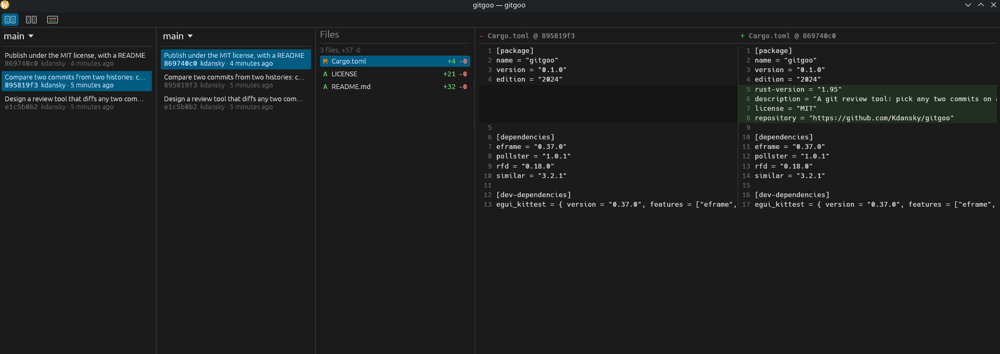

# gitgoo

A git review tool. Pick any two commits, on any two branches, and see everything that differs between them.

Most tools show one commit's changes. gitgoo compares two arbitrary points: skip commits, or put one branch's head against another's.



## Using it

Start the application and pick a repository folder, or run `gitgoo path/to/repo`.

- **First and second column**: two commit histories. The branch name above each opens a map of the branches, drawn leaving and rejoining main; click one to switch.
- **List of files**: the files that differ between the commits picked in A and B, with line counts.
- **Two columns of text**: the picked file, old (A) on the left and new (B) on the right, with changed words marked.

The toolbar switches the diff between the whole file side by side, only the changes, and inline.

Shows UTF-8 files, no binaries or other formats.

## Building

```sh
cargo build --release
cargo test
```

Needs Rust 1.95 or later, and `git` on the PATH. 


## Testing

The UI tests render offscreen through wgpu. Only Linux was tested so far.

[DESIGN.md](DESIGN.md) covers how it works and what comes next.

## License

MIT
